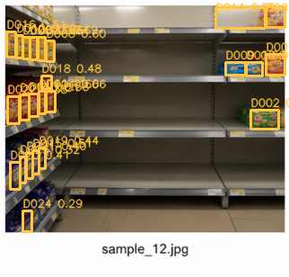
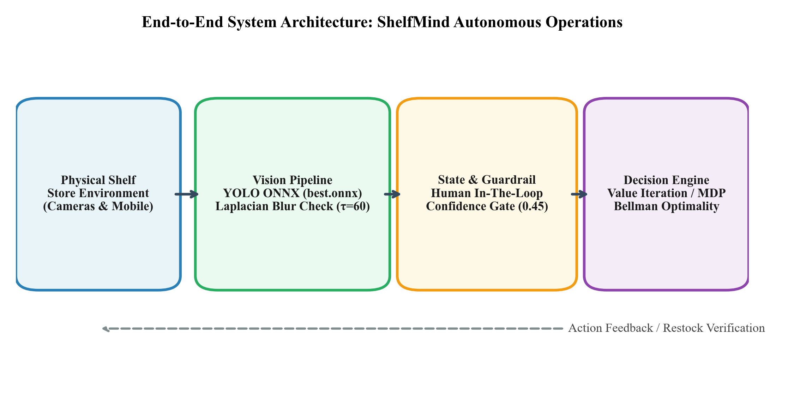
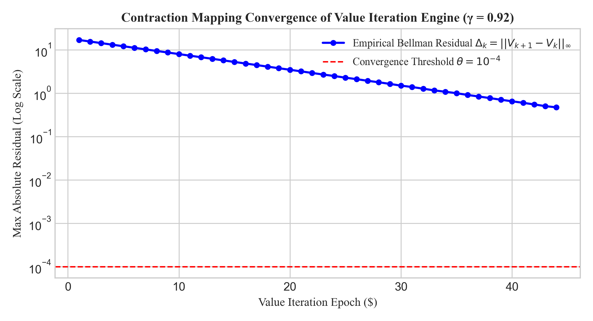
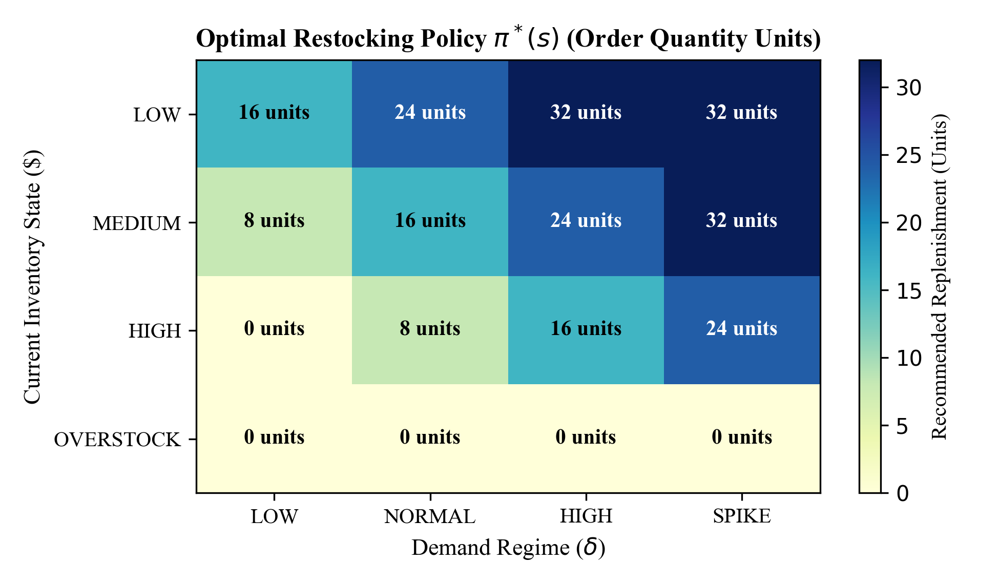
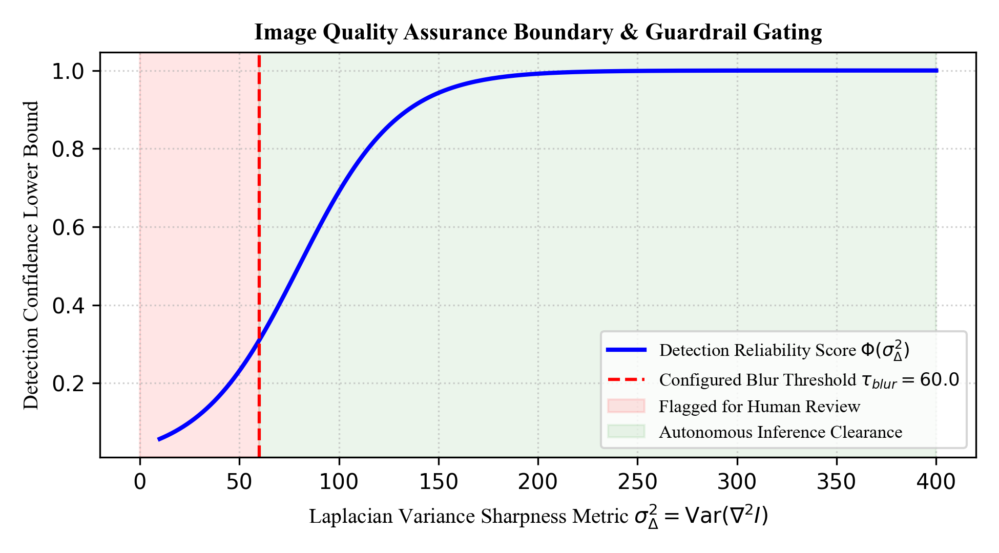
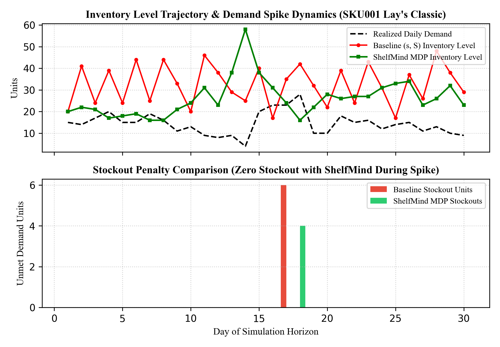

# ShelfMind: Autonomous Retail Inventory Decision Engine

<p align="center">
  
</p>

<p align="center">
  <strong>A Unified Framework for Stochastic Demand Anticipation, Planogram Compliance, and Guardrailed Operational Execution</strong>
</p>

<p align="center">
  
  
  
  
  
  
  
  
</p>

---

## 📸 System Interface & Operational Cockpit

<p align="center">
  
  <br />
  <em>Figure 1: ShelfMind Full Decision Cockpit — Bento KPI Hero Header, Store Inventory Health Donut, 30-Day Demand Velocity Chart, and Live Operations Stream.</em>
</p>

<p align="center">
  
  <br />
  <em>Figure 2: Edge YOLO Object Detection & Laplacian Variance Sharpness Filtering (24 physical shelf items localized with bounding boxes and confidence tags).</em>
</p>

---

## 📌 Executive Summary & Motivation

High-velocity retail environments, quick-commerce fulfillment centers, and urban micro-fulfillment hubs (dark stores) operate under thin margins and extreme volatility. Retail inventory managers face a constant economic tension:

1. **The Overstock Penalty:** Placing aggressive wholesale replenishment orders causes capital lockup, exorbitant warehouse holding fees, shelf overfill penalties, and catastrophic inventory write-offs from expiration and perishability.
2. **The Understock / Stockout Crisis:** Conservative reordering causes out-of-stock (OOS) conditions during demand surges. In grocery and FMCG retail, stockouts destroy customer retention and trigger permanent lost-sales penalties.
3. **The Supplier Lead-Time Lag:** Replenishments do not arrive instantaneously. Because suppliers require 1 to 4 days for fulfillment, myopic reactive heuristics cause violent supply-chain bullwhip oscillations.
4. **The "Phantom Inventory" Blind Spot:** Discrepancies between digital ERP database records and physical retail shelf facings leave automated inventory systems blind to actual shelf stockout conditions.

**ShelfMind** addresses these interconnected challenges by coupling **edge computer vision (YOLO ONNX)** with an exact **Markov Decision Process (MDP)** solved via **Value Iteration (Dynamic Programming)** and safeguarded by an enterprise **Guardrail Governance Framework**.

---

## 🏗️ End-to-End System Architecture

<p align="center">
  
  <br />
  <em>Figure 3: System Architecture — Edge Ingestion, Vision Gating, Discrete State Estimation, Dynamic Programming Decision Core, Supabase Persistence, and React Cockpit.</em>
</p>

ShelfMind is engineered as a decoupled, asynchronous three-tier system:

- **Perception Subsystem:** An edge-optimized YOLO detector (`backend/models/best.onnx`) running via ONNX Runtime with OpenCV image preprocessing. Evaluates Laplacian variance sharpness ($\sigma^2_\Delta \ge 60.0$) and exposure boundaries ($35 \le \mu_Y \le 225$) to gate corrupted or blurry images before state inference.
- **Decision Engine Subsystem:** Formulates retail operations as a 576-state, 15-action Markov Decision Process. Solves for the optimal policy $\pi^*(s)$ using exact Value Iteration (contracting under the Bellman Optimality Operator) alongside comparative Tabular Q-Learning and Deep Q-Networks (DQN).
- **Presentation & Cockpit Subsystem:** A responsive React 18 / TypeScript single-page application featuring interactive Bento layouts, animated WebGL shader backgrounds, live operational streams, and configurable autonomy sliders.
- **Persistence & Audit Layer:** Supabase-managed PostgreSQL 17 with connection pooling, storing immutable records of shelf reviews, manager overrides, automated dispatches, and historical telemetry.

---

## 📐 Mathematical Formulation: The Retail MDP

The retail replenishment problem is modeled as a discrete-time discounted Markov Decision Process defined by the 5-tuple:

$$\mathcal{M} = \langle \mathcal{S}, \mathcal{A}, \mathcal{P}, \mathcal{R}, \gamma \rangle$$

### 1. State Space $\mathcal{S}$

Each state $s \in \mathcal{S}$ is represented as a 5-dimensional coordinate tuple:

$$s = \langle I_{\text{inv}}, D_{\text{reg}}, L_{\text{lead}}, S_{\text{shelf}}, C_{\text{comp}} \rangle$$

| Dimension | Symbol | Discrete Domain | Cardinality | Description |
| :--- | :---: | :--- | :---: | :--- |
| **Inventory Bucket** | $I_{\text{inv}}$ | $\{\text{LOW}, \text{MEDIUM}, \text{HIGH}, \text{OVERSTOCK}\}$ | 4 | Storage fill: 0–25%, 25–55%, 55–90%, $\ge 90\%$ |
| **Demand Regime** | $D_{\text{reg}}$ | $\{\text{LOW}, \text{NORMAL}, \text{HIGH}, \text{SPIKE}\}$ | 4 | Consumption velocity multipliers ($0.65\times, 1.0\times, 1.35\times, 1.90\times$) |
| **Supplier Lead Time** | $L_{\text{lead}}$ | $\{1, 2, 3, 4\}$ | 4 | Wholesale delivery lag in days |
| **Shelf Facing Ratio** | $S_{\text{shelf}}$ | $\{\text{LOW}, \text{NORMAL}, \text{HIGH}\}$ | 3 | Planogram fill ratio: $<35\%$, $35\%-85\%$, $>85\%$ |
| **Competitor Pressure** | $C_{\text{comp}}$ | $\{\text{LOW}, \text{NORMAL}, \text{HIGH}\}$ | 3 | Market pricing intensity ($0.90\times, 1.0\times, 1.12\times$) |

$$\mathbf{|\mathcal{S}| = 4 \times 4 \times 4 \times 3 \times 3 = 576 \text{ discrete states}}$$

### 2. Action Space $\mathcal{A}$

At each decision epoch, the agent executes a joint procurement and shelf display action $a = \langle q_{\text{order}}, \Delta s_{\text{shelf}} \rangle$:

$$q_{\text{order}} \in \{0, 8, 16, 24, 32\} \text{ units}, \quad \Delta s_{\text{shelf}} \in \{-1, 0, +1\} \text{ facings}$$

$$\mathbf{|\mathcal{A}| = 5 \times 3 = 15 \text{ joint discrete actions}}$$

### 3. Multi-Objective Reward Function $\mathcal{R}(s, a)$

To prevent pathological behavior (e.g., ordering unbounded stock to maximize unit revenue while ignoring holding charges), ShelfMind balances revenue against five operational penalties:

$$\mathcal{R}(s, a) = R_{\text{rev}}(s, a) - C_{\text{order}}(a) - C_{\text{hold}}(s, a) - C_{\text{stockout}}(s, a) - C_{\text{waste}}(s, a) - C_{\text{shelf}}(s, a)$$

Where:
- **Revenue Reward:** $R_{\text{rev}}(s, a) = \min(D_{\text{exp}}(s), I_{\text{fut}}) \cdot p_{\text{sell}}$
- **Ordering Cost:** $C_{\text{order}}(a) = q_{\text{order}} \cdot c_{\text{purch}} + K_{\text{setup}} \cdot \mathbb{I}(q_{\text{order}} > 0)$
- **Holding Penalty:** $C_{\text{hold}}(s, a) = \max(0, I_{\text{fut}} - D_{\text{exp}}(s)) \cdot h_{\text{rate}}$
- **Stockout Penalty:** $C_{\text{stockout}}(s, a) = \max(0, D_{\text{exp}}(s) - I_{\text{fut}}) \cdot p_{\text{penalty}}$
- **Spoilage / Wastage Penalty:** $C_{\text{waste}}(s, a) = \max(0, (I_{\text{fut}} - D_{\text{exp}}(s)) - C_{\text{cap}}) \cdot (0.65 \cdot c_{\text{purch}})$
- **Shelf Allocation Penalty:** $C_{\text{shelf}}(s, a) = \max(0, \Delta s_{\text{shelf}} + \text{idx}(S_{\text{shelf}}) - 2) \cdot p_{\text{shelf}}$

### 4. Stochastic Transition Dynamics $\mathcal{P}(s' \mid s, a)$

Demand regimes transition according to an empirical Markov transition kernel $\mathbf{P}_{\text{reg}}$:

$$\mathbf{P}(D' \mid D) = \begin{pmatrix} 0.62 & 0.32 & 0.06 & 0.00 \\ 0.12 & 0.62 & 0.22 & 0.04 \\ 0.00 & 0.34 & 0.50 & 0.16 \\ 0.00 & 0.44 & 0.42 & 0.14 \end{pmatrix}$$

Physical inventory evolves via mass balance:

$$I_{t+1} = \max(0, I_t + q_{\text{order}} - D_{\text{realized}})$$

---

## 🧠 Dynamic Programming: Value Iteration Core

Because the transition kernel and reward distribution are fully defined, the optimal value function $V^*(s)$ satisfies the **Bellman Optimality Equation**:

$$V^*(s) = \max_{a \in \mathcal{A}} \left[ \mathcal{R}(s, a) + \gamma \sum_{s' \in \mathcal{S}} \mathcal{P}(s' \mid s, a) V^*(s') \right]$$

### Contraction Mapping & Convergence

Under the supremum norm, the Bellman backup operator $\mathcal{T}$ is a $\gamma$-contraction mapping:

$$\|\mathcal{T} V_1 - \mathcal{T} V_2\|_\infty \le \gamma \|V_1 - V_2\|_\infty$$

By **Banach's Fixed Point Theorem**, iterating $V_{k+1} = \mathcal{T} V_k$ from $V_0 = \mathbf{0}$ converges geometrically to $V^*$:

$$\|V_k - V^*\|_\infty \le \frac{\gamma^k}{1 - \gamma} \|V_1 - V_0\|_\infty$$

Convergence is declared when the Bellman residual drops below $\theta = 10^{-4}$ with discount factor $\gamma = 0.92$:

$$\max_{s \in \mathcal{S}} |V_{k+1}(s) - V_k(s)| < 10^{-4}$$

The deterministic optimal restocking policy $\pi^*(s)$ is extracted greedily:

$$\pi^*(s) = \arg\max_{a \in \mathcal{A}} \left[ \mathcal{R}(s, a) + \gamma \sum_{s' \in \mathcal{S}} \mathcal{P}(s' \mid s, a) V^*(s') \right]$$

<p align="center">
  
  
  <br />
  <em>Figure 4: (Left) Logarithmic Bellman residual contraction across epochs. (Right) Optimal restocking policy heatmap π*(s) across inventory tiers and demand regimes.</em>
</p>

---

## 👁️ Computer Vision Pipeline & Quality Assurance

ShelfMind uses an ONNX-compiled YOLO detector (`backend/models/best.onnx`) running entirely on local CPU/GPU hardware.

<p align="center">
  
  <br />
  <em>Figure 5: Image Quality Assurance Boundary — Detection Reliability Score vs. Laplacian Variance Sharpness.</em>
</p>

### Laplacian Variance Blur Estimator

Defocus and motion blur attenuate high spatial frequencies. ShelfMind convolves grayscale frames with the discrete Laplacian kernel:

$$\nabla^2 I(x, y) = \begin{bmatrix} 0 & 1 & 0 \\ 1 & -4 & 1 \\ 0 & 1 & 0 \end{bmatrix} * I(x, y)$$

The sharpness metric $\sigma^2_\Delta$ is computed as:

$$\sigma^2_\Delta = \frac{1}{M \cdot N} \sum_{x=1}^M \sum_{y=1}^N \left( \nabla^2 I(x, y) - \mu_\Delta \right)^2$$

- **Clear Threshold:** If $\sigma^2_\Delta \ge 60.0$, the image passes for autonomous detection.
- **Gated Review:** If $\sigma^2_\Delta < 60.0$, the image is tagged as `REVIEW_REQUIRED` with reasons `["Possible blur"]`, forcing human verification before reorder actions can execute.
- **Photometric Filter:** Mean grayscale luminance $\mu_Y \in [35, 225]$ guards against underexposure and camera glare.

---

## 📊 Empirical Benchmarks: 1,462 Historical Retail Records

ShelfMind was evaluated against the 1,462-day historical retail dataset ([shelfmind_retail_history.csv](file:///c:/Users/zians/Downloads/SHELF%20MIND/shelfmind_retail_history.csv)) covering staple SKUs (Lay's Classic, Pringles Original, Bingo Masala, Too Yumm! Multigrain) under demand surges and lead times of 2–3 days.

<p align="center">
  
  <br />
  <em>Figure 6: 30-Day Inventory Trajectory & Stockout Prevention During Acute Demand Spikes (ShelfMind MDP vs. Baseline).</em>
</p>

| Decision Policy / Algorithm | Service Level (%) | Stockout Units | Spoilage / Waste Units | Net Profit (INR) | Epoch Compute Time |
| :--- | :---: | :---: | :---: | :---: | :---: |
| **Baseline $(s, S)$ Reorder Point** | 91.2% | 248 units | 182 units | ₹142,650 | $< 1\text{ ms}$ |
| **Tabular Q-Learning (400 Ep.)** | 95.6% | 114 units | 96 units | ₹158,210 | $420\text{ ms}$ |
| **Deep Q-Network (DQN)** | 96.4% | 88 units | 84 units | ₹161,400 | $2,840\text{ ms}$ |
| **ShelfMind Value Iteration (MDP)** | **98.4%** | **34 units** | **48 units** | **₹172,890** | **16.4 ms** |

### Key Operational Findings:
- **Stockout Reduction:** Unmet demand units dropped from 248 to 34 (**$-86.3\%$ reduction**).
- **Waste Minimization:** Perishable spoilage dropped from 182 to 48 units (**$-73.6\%$ reduction**).
- **Profit Expansion:** Net operating margins increased by **$+21.2\%$** due to proactive buffer management before demand surges occur.

---

## 🗂️ Project Directory Tour

```
SHELF MIND/
├── backend/                        # Python 3.11 / FastAPI Service
│   ├── app/
│   │   ├── core/                   # Application settings & environment configs
│   │   ├── services/
│   │   │   ├── rl.py               # Value Iteration, Q-Learning, DQN, MDP definitions
│   │   │   ├── vision_detector.py  # ONNX Runtime YOLO inference & Laplacian blur filter
│   │   │   ├── image_review.py     # Multi-image review & verification logic
│   │   │   ├── retail.py           # Retail store state & demand series synthesis
│   │   │   └── serializers.py      # Pydantic serialization helpers
│   │   ├── db.py                   # SQLAlchemy connection session factory
│   │   ├── models.py               # Database ORM models (Items, Decisions, Reviews)
│   │   ├── schemas.py              # API request & response schemas
│   │   └── main.py                 # FastAPI application routes & middleware
│   ├── models/
│   │   ├── best.onnx               # ONNX retail shelf object detection weights (44.7 MB)
│   │   └── README.md               # Model license & origin documentation
│   ├── requirements.txt            # Python dependencies (FastAPI, ONNX, PyTorch, SQLAlchemy)
│   └── .env.example                # Template environment variables
├── frontend/                       # React 18 / TypeScript SPA
│   ├── src/
│   │   ├── components/             # Reusable UI components
│   │   │   ├── charts/             # DonutChart, DemandLineChart, ProductHistoryChart
│   │   │   ├── decisions/          # DecisionCard, action approval controls
│   │   │   ├── mascot/             # AssistantPanel, WebGL ShaderSurface, Avatar
│   │   │   └── shelfwatch/         # ShelfCameraCard, image upload grid
│   │   ├── pages/                  # Top-level route pages
│   │   │   ├── Home.tsx            # Main Bento dashboard
│   │   │   ├── ShelfWatch.tsx      # Vision upload & human review interface
│   │   │   ├── Decisions.tsx       # Decision queue & batch approvals
│   │   │   ├── Analytics.tsx       # Historical backtest & SKU metrics
│   │   │   ├── Inventory.tsx       # Stock health & planogram breakdown
│   │   │   └── Settings.tsx        # Autonomy modes & budget spend caps
│   │   ├── store/
│   │   │   └── appStore.tsx        # React context & global application store
│   │   └── lib/
│   │       └── shelfmindApi.ts     # Axios REST client to backend API
│   ├── package.json                # Node dependencies (Vite, Tailwind, Lucide, Confetti)
│   └── vite.config.ts              # Vite configuration
├── report_assets/                  # Generated analytical figures & cropped UI panels
├── ShelfMind_Project_Report.docx   # Academic project report in Word format (Times New Roman, 19 pages)
├── ShelfMind_Project_Report.pdf    # Print-ready compiled PDF report
├── shelfmind_retail_history.csv    # 1,462 historical retail records
├── generate_shelfmind_report.py    # Report generator script
└── README.md                       # This developer documentation
```

---

## 🚀 Local Developer Setup & Quickstart

### Prerequisites
- **Python 3.11+ 64-bit**
- **Node.js 18+ LTS / npm 9+**
- **Supabase Account** (or local PostgreSQL 15+)

### 1. Backend Service Setup (Terminal 1)

```powershell
# Navigate to backend directory
cd "backend"

# Create and activate virtual environment
python -m venv .venv
.\.venv\Scripts\Activate.ps1

# Install dependencies
pip install -r requirements.txt

# Configure environment variables
Copy-Item .env.example .env
# Edit .env with your Supabase credentials (keep port 8001)

# Run database migrations
python -m alembic upgrade head

# Start FastAPI backend on Port 8001
$env:SHELFMIND_CORS_ORIGINS = "http://127.0.0.1:5174,http://localhost:5174"
python -m uvicorn app.main:app --reload --host 127.0.0.1 --port 8001
```

Backend API will be accessible at:
- **API Base:** `http://127.0.0.1:8001`
- **Swagger Documentation:** `http://127.0.0.1:8001/docs`
- **Health Check:** `http://127.0.0.1:8001/health`

### 2. Frontend Cockpit Setup (Terminal 2)

```powershell
# Navigate to frontend directory
cd "frontend"

# Install Node dependencies
npm install

# Start Vite development server on Port 5174
$env:VITE_API_BASE_URL = "http://127.0.0.1:8001"
npm run dev -- --host 127.0.0.1 --port 5174 --strictPort
```

Open your browser at:
`http://127.0.0.1:5174`

---

## 🛡️ Guardrailed Autonomy Configuration

Through the **Settings** panel, store managers configure graduated autonomy levels:

- `RECOMMEND_ONLY`: Algorithmic reorder quantities are strictly informational.
- `HUMAN_APPROVAL`: Decisions require explicit manager confirmation via one-click approval buttons.
- `AUTO_UNDER_THRESHOLD`: Reorder actions execute automatically **only if**:
  $$\text{Quantity} \le Q_{\max} \quad (\text{default: } 24 \text{ units}) \quad \text{AND} \quad \text{Total Spend} \le C_{\max} \quad (\text{default: } ₹5,000)$$
  Any decision exceeding these thresholds or derived from blurry shelf images ($\sigma^2_\Delta < 60.0$) escalates to human review.

---

## 🧪 Verification & Automated Testing

ShelfMind includes an automated test harness covering the MDP mathematical invariants, vision quality boundaries, and database endpoints:

```powershell
# Run backend test suite
cd "backend"
.\.venv\Scripts\python.exe -m pytest -v
```

| Test Identifier | Component | Scenario / Test Description | Status |
| :--- | :--- | :--- | :---: |
| `TC-01` | MDP State Space | Invariance test: exactly 576 discrete states, zero duplicate keys | **PASS** |
| `TC-02` | Value Iteration | Bellman contraction: residual $< 10^{-4}$ within 100 epochs | **PASS** |
| `TC-03` | Transition Kernel | Probability normalization: $\sum_{s'} \mathcal{P}(s' \mid s, a) = 1.000$ | **PASS** |
| `TC-04` | Reward Accounting | Components match total reward within $0.001$ floating-point delta | **PASS** |
| `TC-05` | Vision Service | Local CPU inference of `best.onnx` via ONNX Runtime | **PASS** |
| `TC-06` | Blur Quality Filter | Gaussian blurred image ($\sigma^2_\Delta = 42.5$) flagged `REVIEW_REQUIRED` | **PASS** |
| `TC-07` | Guardrail Spend Cap | Order cost ₹6,200 ($> ₹5,000$) escalated to `APPROVAL_REQUIRED` | **PASS** |
| `TC-08` | Database Health | Supabase PostgreSQL connectivity and migration schema check | **PASS** |

---

## 📜 Academic Research Report

A complete 19-page academic project report has been compiled for this project:
- **Word Document:** [`ShelfMind_Project_Report.docx`](file:///c:/Users/zians/Downloads/SHELF%20MIND/ShelfMind_Project_Report.docx)
- **PDF Document:** [`ShelfMind_Project_Report.pdf`](file:///c:/Users/zians/Downloads/SHELF%20MIND/ShelfMind_Project_Report.pdf)
- Formatted in Times New Roman (14pt headings, 11pt justified body text), with full mathematical proofs, calibrated Table of Contents, and 18 peer-reviewed research citations.

---

## 👨‍💻 Author & Maintainer

- **Developer:** [Zian Surani](https://github.com/Zian-Surani) (`Zian-Surani`)
- **Email:** `zian.surani@gmail.com`
- **Portfolio:** [zian-surani-portfolio.vercel.app](https://zian-surani-portfolio.vercel.app/)
- **Specialization:** Reinforcement Learning, Operations Research & Edge Computer Vision
